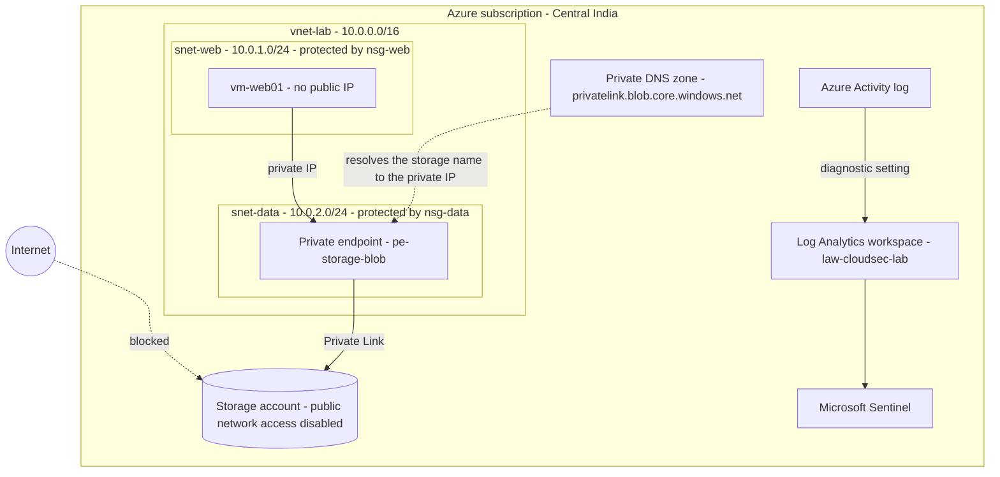

# Cloud Security Homelab: Azure Setup Guide

A step-by-step guide to building a small, low-cost cloud security lab in Microsoft Azure using only the free account and Azure Cloud Shell. Nothing needs to be installed on your computer.

By the end you will have:

- A private network (VNet) split into a web subnet and a data subnet, each protected by its own firewall rules (NSG)
- A Linux VM with **no public IP address**
- A storage account reachable **only through a private endpoint**
- A Log Analytics workspace collecting the Azure Activity log
- Microsoft Sentinel (a SIEM) enabled on that workspace

Once this is done, continue with [README.md](README.md), where the lab is used to build and test a detection rule.

> **Scope:** this is a personal learning lab built in my own free Azure account. It is not a production design.

---

## 1. Architecture



### Key ideas in plain language

| Term | What it means |
|---|---|
| **Resource group** | A folder that holds everything for this lab. Delete the folder and everything inside is deleted. |
| **VNet (virtual network)** | Your own private network inside Azure. Isolated by default. |
| **Subnet** | A slice of the VNet. Used to group resources by role and give each group its own rules. |
| **NSG (network security group)** | A firewall attached to a subnet. Each rule has a priority, source, destination, port, and allow/deny. |
| **Private endpoint** | A network interface with a private IP in your subnet that connects to an Azure service (here, Storage). Traffic never uses the public internet. |
| **Private DNS zone** | Makes the storage account's normal name resolve to the private IP, but only inside your VNet. |
| **Log Analytics workspace** | The database where logs are stored and queried with KQL. |
| **Microsoft Sentinel** | A SIEM that runs on top of a Log Analytics workspace: detection rules, incidents, hunting. |

### Address ranges

- `10.0.0.0/16` is the whole VNet (about 65,000 addresses).
- `10.0.1.0/24` and `10.0.2.0/24` are two non-overlapping slices (256 addresses each).
- Azure reserves 5 addresses in every subnet, so each `/24` has **251 usable** addresses.

---

## 2. Prerequisites and cost

You need:

- A Microsoft account
- A phone number and a card for identity verification when creating the Azure free account
- A browser

**Cost:** the Azure free account provides a $200 credit that must be used within 30 days. In my run, the first three days of the lab (with the VM mostly switched off) cost about ₹90 (roughly $1). The private endpoint was the biggest item. Check **Cost Management > Cost analysis** for your own numbers, because prices and usage differ.

> The VNet, subnets, and NSGs are free. Log Analytics and Sentinel were covered by the Sentinel free trial while data stayed under 10 GB/day.

---

## 3. Create the Azure account and a budget alert

### 3.1 Create the free account

1. Go to the Azure free account page and sign up with a Microsoft account.
2. Complete phone and card verification.
3. Open the Azure portal at `portal.azure.com`.

**Good to know**

- The $200 credit expires **30 days after signup**, whether or not you use it.
- You can only have one free trial per customer.
- When the credit ends, the subscription stops unless you upgrade. Do not upgrade unless you decide to.

### 3.2 Create a budget alert (do this before building anything)

A budget only **sends warnings**. It does not stop spending.

1. In the portal, open **Cost Management > Budgets > Add**.
2. Name: `lab-budget`. Reset period: Monthly. Set an expiry date after your credit ends.
3. Amount: `20` (USD).
4. On the alert page, add:
   - Actual cost at 50%, 90%, and 100%
   - Forecasted cost at 100% (warns you early if you are on track to overspend)
5. Enter an email address you actually check, then click **Create**.

---

## 4. Open Azure Cloud Shell

1. Click the `>_` icon in the top bar of the portal.
2. Choose **Bash**.
3. If asked about storage, choose the option that says no storage account is required.

Confirm you are in the right subscription:

```bash
az account show --query "{name:name, state:state}" -o table
```

The state should be `Enabled`.

> **Tip:** if Cloud Shell restarts, shell variables (for example `STORAGE`) are lost. Re-set them before continuing.

---

## 5. Register the Azure services you will use

A new subscription does not have every Azure service switched on. If a service is not "registered", creating resources from it fails, and the error message can be confusing (I got `SubscriptionNotFound` and `InvalidAuthenticationToken` for this reason). Register them up front:

```bash
az provider register -n Microsoft.Storage --wait
az provider register -n Microsoft.OperationalInsights --wait
az provider register -n Microsoft.Insights --wait
```

- `-n` is the service category (called a resource provider).
- `--wait` pauses until registration finishes, which can take 1-2 minutes.

Check any of them:

```bash
az provider show -n Microsoft.Insights --query registrationState -o tsv
```

It should print `Registered`.

---

## 6. Create the resource group

```bash
az group create \
  --name rg-cloudsec-lab \
  --location centralindia \
  --tags purpose=cloudsec-lab delete-by=YYYY-MM-DD
```

| Parameter | Meaning |
|---|---|
| `--name` | Name of the resource group. Every later command refers to it. |
| `--location` | Azure region. Keep **every** resource in the same region. |
| `--tags` | Labels. `delete-by` is a reminder of when to clean up. Replace the date. |

A successful run prints JSON containing `"provisioningState": "Succeeded"`.

---

## 7. Build the network

### 7.1 VNet and the web subnet

```bash
az network vnet create \
  -g rg-cloudsec-lab -n vnet-lab -l centralindia \
  --address-prefixes 10.0.0.0/16 \
  --subnet-name snet-web --subnet-prefixes 10.0.1.0/24
```

### 7.2 Data subnet

```bash
az network vnet subnet create \
  -g rg-cloudsec-lab --vnet-name vnet-lab \
  -n snet-data --address-prefixes 10.0.2.0/24
```

### 7.3 Two NSGs

```bash
az network nsg create -g rg-cloudsec-lab -n nsg-web -l centralindia
az network nsg create -g rg-cloudsec-lab -n nsg-data -l centralindia
```

### 7.4 NSG rules

```bash
# Web subnet: allow HTTPS from the internet
az network nsg rule create -g rg-cloudsec-lab --nsg-name nsg-web \
  -n allow-https-inbound --priority 100 --direction Inbound --access Allow \
  --protocol Tcp --source-address-prefixes Internet --source-port-ranges '*' \
  --destination-address-prefixes '*' --destination-port-ranges 443

# Data subnet: allow SQL only from the web subnet
az network nsg rule create -g rg-cloudsec-lab --nsg-name nsg-data \
  -n allow-sql-from-web --priority 100 --direction Inbound --access Allow \
  --protocol Tcp --source-address-prefixes 10.0.1.0/24 --source-port-ranges '*' \
  --destination-address-prefixes '*' --destination-port-ranges 1433

# Data subnet: deny everything else inbound
az network nsg rule create -g rg-cloudsec-lab --nsg-name nsg-data \
  -n deny-all-other-inbound --priority 4000 --direction Inbound --access Deny \
  --protocol '*' --source-address-prefixes '*' --source-port-ranges '*' \
  --destination-address-prefixes '*' --destination-port-ranges '*'
```

| Parameter | Meaning |
|---|---|
| `--priority` | Lower number is evaluated first (100 beats 4000). |
| `--direction` | `Inbound` = traffic coming into the subnet. |
| `--access` | `Allow` or `Deny`. |
| `--source-address-prefixes` | Where traffic comes from (`Internet`, or an IP range). |
| `--destination-port-ranges` | The port being protected (443 = HTTPS, 1433 = SQL Server). |

**Why the explicit deny rule matters:** every NSG has built-in default rules, including one at priority 65000 that allows all traffic between resources in the same VNet. Without the explicit deny at priority 4000, the data subnet would still accept any port from any other subnet, not only SQL from the web tier. This is a very common misconfiguration.

### 7.5 Attach each NSG to its subnet

```bash
az network vnet subnet update -g rg-cloudsec-lab --vnet-name vnet-lab \
  -n snet-web --network-security-group nsg-web
az network vnet subnet update -g rg-cloudsec-lab --vnet-name vnet-lab \
  -n snet-data --network-security-group nsg-data
```

### 7.6 Verify

```bash
az network vnet subnet list -g rg-cloudsec-lab --vnet-name vnet-lab \
  --query "[].{name:name, prefix:addressPrefix, nsg:networkSecurityGroup.id}" -o table
```

Both subnets should show an NSG ID.

---

## 8. Create a VM with no public IP

```bash
az vm create \
  -g rg-cloudsec-lab -n vm-web01 \
  --image Ubuntu2204 --size <SIZE> \
  --vnet-name vnet-lab --subnet snet-web \
  --public-ip-address "" --nsg "" \
  --admin-username azureuser --generate-ssh-keys \
  --storage-sku Standard_LRS
```

| Parameter | Meaning |
|---|---|
| `--size` | VM size. See the note below about availability. |
| `--public-ip-address ""` | No public IP, so the VM cannot be reached from the internet. |
| `--nsg ""` | Do not create a second NSG. The subnet already has `nsg-web`. |
| `--generate-ssh-keys` | Creates an SSH key. You will not need it, so never upload it anywhere. |

### Size availability problem

`Standard_B1s` returned `SkuNotAvailable` in Central India for my subscription (a capacity restriction on Azure's side). A loop that tries several sizes and stops at the first success worked:

```bash
for SIZE in Standard_B1ls Standard_B2ats_v2 Standard_B2s Standard_B2ls_v2 Standard_D2s_v3 Standard_D2as_v5; do
  echo "Trying $SIZE ..."
  az vm create -g rg-cloudsec-lab -n vm-web01 \
    --image Ubuntu2204 --size $SIZE \
    --vnet-name vnet-lab --subnet snet-web \
    --public-ip-address "" --nsg "" \
    --admin-username azureuser --generate-ssh-keys \
    --storage-sku Standard_LRS && break
done
```

Each failed attempt prints a long error, so ignore those and look for `"powerState": "VM running"`. In my case `Standard_D2as_v5` succeeded. The `D` sizes cost more per hour than the `B` sizes, so always deallocate the VM when you are done.

### Verify without opening any port

```bash
az vm run-command invoke -g rg-cloudsec-lab -n vm-web01 \
  --command-id RunShellScript \
  --scripts "hostname; ip -4 addr show eth0 | grep inet"
```

`run-command` runs a command inside the VM through the Azure control plane, so no SSH or public IP is needed. The `message` field in the output should show an address like `10.0.1.4/24`.

### Stop the compute charge

```bash
az vm deallocate -g rg-cloudsec-lab -n vm-web01
```

Only **deallocated** stops compute billing. A VM shut down from inside the operating system still bills. Start it again with:

```bash
az vm start -g rg-cloudsec-lab -n vm-web01
```

---

## 9. Storage account with a private endpoint

### 9.1 Create the storage account

```bash
STORAGE=<your-unique-name>   # 3-24 characters, lowercase letters and numbers only

az storage account create \
  -g rg-cloudsec-lab -n $STORAGE -l centralindia \
  --sku Standard_LRS --kind StorageV2 \
  --allow-blob-public-access false --min-tls-version TLS1_2
```

| Parameter | Meaning |
|---|---|
| `STORAGE=` | Storage names must be globally unique across all of Azure. Pick your own. |
| `--sku Standard_LRS` | Cheapest redundancy (three copies in one datacenter). |
| `--allow-blob-public-access false` | Blocks anonymous public access to blobs. |
| `--min-tls-version TLS1_2` | Rejects old, weak encryption. |

### 9.2 Create the private endpoint in the data subnet

```bash
STORAGE_ID=$(az storage account show -g rg-cloudsec-lab -n $STORAGE --query id -o tsv)

az network private-endpoint create \
  -g rg-cloudsec-lab -n pe-storage-blob -l centralindia \
  --vnet-name vnet-lab --subnet snet-data \
  --private-connection-resource-id $STORAGE_ID \
  --group-id blob --connection-name conn-storage-blob
```

| Parameter | Meaning |
|---|---|
| `--subnet snet-data` | The subnet that provides the endpoint's private IP. |
| `--private-connection-resource-id` | The storage account the endpoint connects to. |
| `--group-id blob` | Which part of the account to expose. `blob` covers object storage. |

### 9.3 Private DNS, so the storage name resolves to the private IP

```bash
az network private-dns zone create -g rg-cloudsec-lab \
  -n privatelink.blob.core.windows.net

az network private-dns link vnet create -g rg-cloudsec-lab \
  -z privatelink.blob.core.windows.net -n link-vnet-lab -v vnet-lab -e false

az network private-endpoint dns-zone-group create -g rg-cloudsec-lab \
  --endpoint-name pe-storage-blob -n zg-blob \
  --private-dns-zone privatelink.blob.core.windows.net --zone-name blob
```

The zone name `privatelink.blob.core.windows.net` is required for blob storage. Do not rename it. Skipping DNS is the most common reason a private endpoint "does not work": the VM would still resolve the storage name to the public address.

### 9.4 Prove it works

From **inside** the VNet (through the VM):

```bash
az vm run-command invoke -g rg-cloudsec-lab -n vm-web01 \
  --command-id RunShellScript \
  --scripts "getent hosts $STORAGE.blob.core.windows.net"
```

From **outside** (Cloud Shell, which is not in your VNet):

```bash
getent hosts $STORAGE.blob.core.windows.net
```

| Where you ask | Result |
|---|---|
| Inside the VNet | A private address in `10.0.2.x` |
| Outside the VNet | A public address |

The same name resolving to two different answers is how a private endpoint works.

### 9.5 Close the public door

```bash
az storage account update -g rg-cloudsec-lab -n $STORAGE \
  --public-network-access Disabled

az storage account show -g rg-cloudsec-lab -n $STORAGE \
  --query publicNetworkAccess -o tsv
```

The second command should print `Disabled`.

### 9.6 Test the block

From outside the VNet, a request for the container list should now be refused:

```bash
curl -i "https://$STORAGE.blob.core.windows.net/?comp=list"
```

Expect `403` with error code `AuthorizationFailure` (blocked at the network layer).

From inside the VNet, the same request gets through the network but is refused by the account's own settings:

```bash
az vm run-command invoke -g rg-cloudsec-lab -n vm-web01 \
  --command-id RunShellScript \
  --scripts "curl -s -i 'https://$STORAGE.blob.core.windows.net/?comp=list'"
```

Expect `409` with error code `PublicAccessNotPermitted` (anonymous access is disabled on the account). Two layers, two different refusals: this is defense in depth.

> Note that `curl` against the bare root address (without `?comp=list`) returned `400 InvalidQueryParameterValue`, which proves nothing about the network block. Use a well-formed request for your test.

---

## 10. Log Analytics workspace

```bash
az monitor log-analytics workspace create \
  -g rg-cloudsec-lab -n law-cloudsec-lab -l centralindia \
  --sku PerGB2018 --retention-time 30
```

Add a daily ingestion cap so a runaway log source cannot burn your credit:

```bash
az monitor log-analytics workspace update \
  -g rg-cloudsec-lab -n law-cloudsec-lab --quota 1
```

`--quota 1` is the daily limit in GB.

---

## 11. Send the Azure Activity log to the workspace

The Activity log records who created, changed, or deleted resources in your subscription. It is the data source for the detection in [README.md](README.md).

```bash
LAW_ID=$(az monitor log-analytics workspace show \
  -g rg-cloudsec-lab -n law-cloudsec-lab --query id -o tsv)

az monitor diagnostic-settings subscription create \
  --name ds-activity-to-law \
  --location centralindia \
  --workspace $LAW_ID \
  --logs '[{"category":"Administrative","enabled":true},{"category":"Security","enabled":true}]'
```

| Parameter | Meaning |
|---|---|
| `--name` | Name of the diagnostic setting. |
| `--workspace` | Destination workspace. |
| `--logs` | Which Activity log categories to send. `Administrative` = create/update/delete operations. `Security` = security alerts. Keep the single quotes around the whole list. |

### Verify that data actually arrives

Create a harmless event, then query for it (give it 15-20 minutes):

```bash
az group update -n rg-cloudsec-lab --set tags.check=1
```

In the workspace **Logs** page:

```kusto
AzureActivity
| take 10
```

> **Troubleshooting note:** in my lab, the setting looked correct in both the CLI and the portal, but the `AzureActivity` table stayed empty for over an hour. After I edited the setting in the portal (adding the `Policy` category and saving), data started flowing within minutes. I cannot say for certain why the first version delivered nothing. The lesson is that a setting that looks right is not proof: **the only real proof is rows in the table.**

---

## 12. Enable Microsoft Sentinel

1. In the Azure portal, search for **Microsoft Sentinel**, click **Create**, select `law-cloudsec-lab`, then **Add**.
2. A free trial starts automatically. In my lab it ran for 31 days, with the first 10 GB/day free for both Sentinel and Log Analytics.
3. Sentinel is moving into the **Microsoft Defender portal** (`security.microsoft.com`). The Azure portal's Content hub page told me the page had moved there. Open the Defender portal and sign in with the same account.
4. Go to **System > Settings > Microsoft Sentinel** and confirm `law-cloudsec-lab` shows **Connected** and **Primary**. (Mine was connected automatically.)
5. Go to **Microsoft Sentinel > Content management > Content hub**, search for **Azure Activity**, and click **Install**. This adds rule templates, a workbook, and hunting queries. Do not enable any templates yet.

No Defender XDR or E5 license was required in my case.

---

## 13. Daily routine and cost control

- Deallocate the VM after every session: `az vm deallocate -g rg-cloudsec-lab -n vm-web01`
- Check **Cost Management > Cost analysis** every few days
- Keep everything inside the one resource group so cleanup is a single command

Items that keep billing a small amount while they exist: the private endpoint, the VM disk, the private DNS zone, and the storage account.

---

## 14. Cleanup

When you are finished, delete everything in one command. This is irreversible.

```bash
az group delete --name rg-cloudsec-lab --yes --no-wait
```

Diagnostic settings at the subscription level and Sentinel content may remain as separate items. Check the portal afterwards.

---

## 15. Troubleshooting summary

| Symptom | Likely cause | Fix |
|---|---|---|
| `SubscriptionNotFound` when creating storage | `Microsoft.Storage` not registered | `az provider register -n Microsoft.Storage --wait` |
| `InvalidAuthenticationToken ... register the subscription with Microsoft.Insights` | `Microsoft.Insights` not registered | `az provider register -n Microsoft.Insights --wait` |
| `SkuNotAvailable` for a VM size | No capacity for that size in the region | Try other sizes (loop in section 8) or another region |
| Storage name resolves to a public IP inside the VM | Private DNS not set up | Redo section 9.3 |
| `AzureActivity` table is empty | Diagnostic setting not delivering | Re-save the setting in the portal; wait 15-20 minutes; check the table, not the setting |
| Budget form will not accept typing | Browser extension or portal glitch | Refresh, or use an InPrivate/Incognito window |

---

**Next:** [README.md](README.md) shows how this lab is used to build and test a Microsoft Sentinel detection rule.
