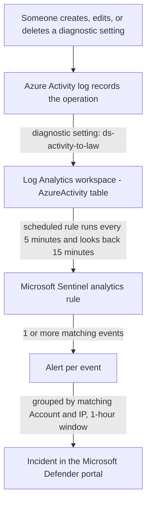

# Detecting "Disable or Modify Cloud Logs" in Azure with Microsoft Sentinel

A hands-on lab that builds a Microsoft Sentinel detection rule to alert when someone **creates, changes, or deletes a diagnostic setting** in an Azure subscription, a common way for attackers to hide their tracks.

> **Status:** personal learning project in my own free Azure account. Built while learning Azure cloud security, with a focus on the Microsoft ecosystem.

**Contents**

1. [Why this detection matters](#1-why-this-detection-matters)
2. [How it works (architecture)](#2-how-it-works-architecture)
3. [Prerequisites](#3-prerequisites)
4. [Step 1: Confirm the logs are flowing](#4-step-1-confirm-the-logs-are-flowing)
5. [Step 2: Write and test the query](#5-step-2-write-and-test-the-query)
6. [Step 3: Create the analytics rule](#6-step-3-create-the-analytics-rule)
7. [Step 4: Test the detection](#7-step-4-test-the-detection)
8. [Results](#8-results)
9. [Tuning and limitations](#9-tuning-and-limitations)
10. [Lessons learned](#10-lessons-learned)
11. [What I would do next](#11-what-i-would-do-next)
12. [References](#12-references)

---

## 1. Why this detection matters

In Azure, a **diagnostic setting** decides which logs are sent to a destination such as a Log Analytics workspace (where a SIEM reads them). If an attacker gets into a cloud account, one of the first things they may do is **switch off or redirect logging**, so that their later actions leave no trace.

That behaviour is catalogued in MITRE ATT&CK as:

- **Tactic:** Defense Evasion
- **Technique:** [T1562.008 - Impair Defenses: Disable or Modify Cloud Logs](https://attack.mitre.org/techniques/T1562/008/)

A SOC wants to know about it immediately, because everything that happens *after* the logging change may be invisible.

---

## 2. How it works (architecture)



**Data flow in plain language**

1. Every management action in Azure (create, update, delete) is written to the **Activity log**.
2. A **diagnostic setting** copies that log into a **Log Analytics workspace**, where it appears in the `AzureActivity` table.
3. A **Sentinel scheduled analytics rule** runs a KQL query against that table on a schedule.
4. If the query returns any rows, Sentinel raises an **alert**, and alerts are grouped into an **incident** that an analyst can investigate.

The infrastructure behind this (network, VM, storage with a private endpoint, workspace, Sentinel) is built in [LAB-SETUP.md](LAB-SETUP.md).

---

## 3. Prerequisites

- The lab from [LAB-SETUP.md](LAB-SETUP.md), up to and including:
  - A Log Analytics workspace (`law-cloudsec-lab`)
  - The Activity log diagnostic setting (`ds-activity-to-law`)
  - Microsoft Sentinel enabled on that workspace
  - (Optional) the **Azure Activity** solution installed from the Content hub, which provides ready-made rule templates to read
- Permissions to create analytics rules in Sentinel (for a personal subscription, being the owner is enough in my case)

---

## 4. Step 1: Confirm the logs are flowing

A detection rule can only react to data that exists. Before writing it, check that the Activity log reaches the workspace.

In the workspace **Logs** page, set the time range to **Last 24 hours** and run:

```kusto
AzureActivity
| take 10
```

You should see rows with columns such as `TimeGenerated`, `Caller`, and `OperationNameValue`. If the table is empty, go back to section 11 of [LAB-SETUP.md](LAB-SETUP.md).

> Every operation appears **twice**, once with `ActivityStatusValue` = `Start` and once with `Success` (or `Failure`). Detections normally filter on the final status so each action is counted once.

---

## 5. Step 2: Write and test the query

Run this in **Logs** with a time range wide enough to include a past diagnostic-setting change (for example, last 7 days):

```kusto
AzureActivity
| where OperationNameValue in~ ("MICROSOFT.INSIGHTS/DIAGNOSTICSETTINGS/WRITE", "MICROSOFT.INSIGHTS/DIAGNOSTICSETTINGS/DELETE")
| where ActivityStatusValue == "Success"
| project TimeGenerated, Caller, CallerIpAddress, OperationNameValue, SubscriptionId
```

**What each line does**

| Line | Purpose |
|---|---|
| `AzureActivity` | The table holding the subscription's Activity log. |
| `where OperationNameValue in~ (...)` | Keeps only events where a diagnostic setting was created or edited (`WRITE`) or removed (`DELETE`). The `~` makes the match case-insensitive. |
| `where ActivityStatusValue == "Success"` | Keeps only completed actions and drops the duplicate `Start` rows. |
| `project ...` | Chooses the columns an analyst needs: when, who (`Caller`), from which IP (`CallerIpAddress`), what, and which subscription. |

**Expected result:** at least one row for your own change, with your account under `Caller`. `CallerIpAddress` is the first thing an analyst checks: does the address belong to the admin who made the change?

> I used `SubscriptionId` and not `ResourceGroup`, because a diagnostic setting at subscription level has no resource group, so that column came back blank.

---

## 6. Step 3: Create the analytics rule

In the **Microsoft Defender portal** (`security.microsoft.com`): **Microsoft Sentinel > Configuration > Analytics > Create > Scheduled query rule**.

### 6.1 General tab

| Field | Value | Why |
|---|---|---|
| Name | `Diagnostic setting changed or deleted` | Clear name for the incident list. |
| Description | `Detects when a diagnostic setting is created, modified, or deleted. Attackers may disable logging to hide activity.` | Appears in the alert, so write it for the analyst. |
| Severity | Medium | Lab setting. In production, raise it for changes outside a maintenance window. |
| MITRE ATT&CK | Defense Evasion, T1562.008 | Tags the alert with the attacker behaviour it covers. |
| Status | Enabled | A disabled rule exists but never runs. |

### 6.2 Set rule logic tab

**Rule query:** paste the query from Step 2. Remove any time filter, because the scheduling fields control the time window.

```kusto
AzureActivity
| where OperationNameValue in~ ("MICROSOFT.INSIGHTS/DIAGNOSTICSETTINGS/WRITE", "MICROSOFT.INSIGHTS/DIAGNOSTICSETTINGS/DELETE")
| where ActivityStatusValue == "Success"
| project TimeGenerated, Caller, CallerIpAddress, OperationNameValue, SubscriptionId
```

Clicking **View query results** will probably show no results if your last change was more than 15 minutes ago. That is expected.

**Entity mapping** (links the alert to the *who* and *where*, so an analyst can click through):

| Entity | Identifier | Mapped column |
|---|---|---|
| Account | FullName | `Caller` |
| IP | Address | `CallerIpAddress` |

**Query scheduling**

| Setting | Value | Why |
|---|---|---|
| Run query every | 5 minutes | The shortest allowed interval, so test alerts appear quickly. |
| Lookup data from the last | 15 minutes | Longer than the run interval on purpose: Activity log events can arrive late, and a 5-minute lookback could miss a delayed event. |
| Start running | Automatically | |

**Alert threshold:** generate an alert when the number of query results is **greater than 0** (a single matching event is enough).

**Event grouping:** **Trigger an alert for each event**. Every diagnostic-setting change is a separate, sensitive action and deserves its own alert.

**Suppression:** off.

> **Trade-off:** because the lookback (15 min) is longer than the interval (5 min), one event can be seen by up to three consecutive runs and raise up to three alerts. The incident grouping settings below absorb this.

### 6.3 Incident settings tab

| Setting | Value | Why |
|---|---|---|
| Create incidents from alerts | Enabled | Without this, alerts exist but nobody is notified. |
| Group related alerts into incidents | Enabled | Merges the duplicate alerts into one incident. |
| Grouping method | Group alerts if **all the entities match** | Works because Account and IP are mapped: each person's activity from one address becomes one incident. |
| Time frame | 1 hour | Alerts within an hour of the first are added to the same incident. |
| Re-open closed incidents | Disabled | A closed incident stays closed. |
| Incident correlation | Tenant default | |

### 6.4 Automated response tab

Nothing configured. No automation rules or playbooks yet.

### 6.5 Review + create

Confirm **Validation passed** and that the summary matches the tables above, then click **Save**. The rule appears in the Analytics list as **Enabled**.

---

## 7. Step 4: Test the detection

The rule will not fire by itself, because earlier changes are outside the 15-minute window. Trigger it deliberately with a harmless change to the diagnostic setting.

**1. Note the time (UTC):**

```bash
date -u
```

**2. Re-save the setting, adding the low-volume `Policy` category:**

```bash
LAW_ID=$(az monitor log-analytics workspace show \
  -g rg-cloudsec-lab -n law-cloudsec-lab --query id -o tsv)

az monitor diagnostic-settings subscription create \
  --name ds-activity-to-law \
  --location centralindia \
  --workspace $LAW_ID \
  --logs '[{"category":"Administrative","enabled":true},{"category":"Security","enabled":true},{"category":"Policy","enabled":true}]'
```

Keep the same setting name so that this updates the existing setting and does not create a second one.

**3. Confirm the event reached the workspace** (wait 5-10 minutes, time range *Last hour*):

```kusto
AzureActivity
| where OperationNameValue =~ "MICROSOFT.INSIGHTS/DIAGNOSTICSETTINGS/WRITE"
| project TimeGenerated, Caller, CallerIpAddress
| sort by TimeGenerated desc
```

`CallerIpAddress` will probably differ from your usual browser address, because the command came from Cloud Shell. Cloud Shell's outgoing address can change between sessions, so compare it with the address recorded in the log rather than assuming.

**4. Look for the incident** (usually 10-20 minutes in total): in the Defender portal, open **Investigation & response > Incidents & alerts > Incidents** and look for **Diagnostic setting changed or deleted**. If the path differs in your portal, look for an Incidents page under Microsoft Sentinel.

---

## 8. Results

The detection worked end to end in my lab.

| Check | Result |
|---|---|
| Test event | One `DIAGNOSTICSETTINGS/WRITE` event at 06:09 UTC (11:39 IST), made by my own account |
| Alerts | **3** alerts raised for that single event |
| Incidents | The 3 alerts were grouped into **1** incident: *Diagnostic setting changed or deleted* (Medium, Defense evasion) |
| Entity mapping | The incident listed my account as an impacted asset and showed the source IP as evidence |
| Defender verdict | The IP was automatically marked **Suspicious** |
| Outcome | I investigated, concluded it was my own test change, and resolved the incident with a comment |

### Screenshots

**The incident in the Incidents list**


**The three alerts inside the incident**


**Evidence: the source IP and its verdict**


**The matching event in the `AzureActivity` table**


**Resolving the incident**


### What I found

- **One event, three alerts, one incident.** The query returned a single event, but the rule raised three alerts: it runs every 5 minutes and looks back 15, so consecutive runs read the same event. Because the alerts share the same account and IP, the incident grouping merged them into one incident, which is what the settings in section 6 were designed to do.
- **An automatic "Suspicious" verdict is a starting point, not a conclusion.** Defender marked the source IP as suspicious, but the activity was my own test. The caller, the operation, and the time all matched what I did.
- **The source IP differed from my browser's address.** I ran the change from Cloud Shell, and I did not verify that the recorded IP belongs to Cloud Shell. Cloud Shell sessions are ephemeral, and a later lookup returned a different address, so I treat the IP as weak evidence by itself.
- **Time zones differ between screens.** The Defender portal showed local time (IST), while the Logs page shows UTC. 11:39 IST and 06:09 UTC are the same moment.

### How I triaged it

1. Opened the incident and checked the **Alerts** tab (3 alerts) and the **Evidence** tab (one IP address, verdict *Suspicious*).
2. Queried `AzureActivity` and found the matching event: same account, same time, same operation.
3. Concluded it was my own change, and resolved the incident with a comment explaining that it was a test.

> Screenshots are blurred or cropped to hide subscription IDs, workspace IDs, email addresses, and IP addresses.

---

## 9. Tuning and limitations

- **It fires on legitimate changes too.** The rule cannot tell an admin's planned change from an attacker's. In a real SOC, you tune it, for example by excluding known admin accounts or approved change windows:

  ```kusto
  AzureActivity
  | where OperationNameValue in~ ("MICROSOFT.INSIGHTS/DIAGNOSTICSETTINGS/WRITE", "MICROSOFT.INSIGHTS/DIAGNOSTICSETTINGS/DELETE")
  | where ActivityStatusValue == "Success"
  | where Caller !in ("approved-admin@example.com")
  ```

- **Detection depends on logging staying alive.** If an attacker deletes the diagnostic setting, the event that records the deletion is itself written to the Activity log before delivery stops. That is why the `DELETE` operation is in the query, but the timing in a real incident is worth testing.
- **Delivery delay.** Activity log events can take several minutes to reach the workspace, so the end-to-end alert is not instant.
- **Medium severity is a lab choice.** Severity should reflect your environment.
- **One rule is not coverage.** This covers a single technique. Other logging-evasion routes (for example, changing a workspace's configuration or disabling a data connector) need their own detections.

---

## 10. Lessons learned

- **Register Azure services early.** Three different errors (`SubscriptionNotFound`, `InvalidAuthenticationToken`, and a provider-registration message) all came from services that were not registered on a new subscription.
- **A setting that looks right is not proof.** The diagnostic setting looked correct in both the CLI and the portal, yet delivered nothing until it was re-saved. The only real proof is rows in the table.
- **Test the query before turning it into a rule.** It is much faster to fix a query in the Logs page than inside the rule wizard.
- **Lookback and interval interact.** A lookback longer than the run interval protects against late-arriving data but creates duplicate alerts, so incident grouping matters.
- **Entities make incidents useful.** Mapping Account and IP lets an analyst pivot from the incident and lets grouping work by who and where.
- **Defense in depth is visible in the errors.** Outside the VNet, storage access was blocked at the network layer (`403 AuthorizationFailure`). Inside, the network allowed it and the account's own setting refused it (`409 PublicAccessNotPermitted`).
- **Verify automatic verdicts.** Defender flagged my own test activity as suspicious. A verdict or an IP address on its own is not proof, so check the caller, the operation, and the time before closing an incident.

---

## 11. What I would do next

- Add a second rule for **role assignments created outside a change window** (privilege escalation)
- Detect **failed sign-ins followed by a success** (password spray or MFA fatigue patterns) using Entra ID sign-in logs
- Move the setup into **Bicep or Terraform** so the lab can be rebuilt in minutes
- Add **Defender for Cloud** posture recommendations and compare them with what I built by hand
- Tune the rule with an allow-list and test how it behaves with several users

---

## 12. References

- MITRE ATT&CK: [T1562.008 Impair Defenses: Disable or Modify Cloud Logs](https://attack.mitre.org/techniques/T1562/008/)
- Lab infrastructure and setup steps: [LAB-SETUP.md](LAB-SETUP.md)
